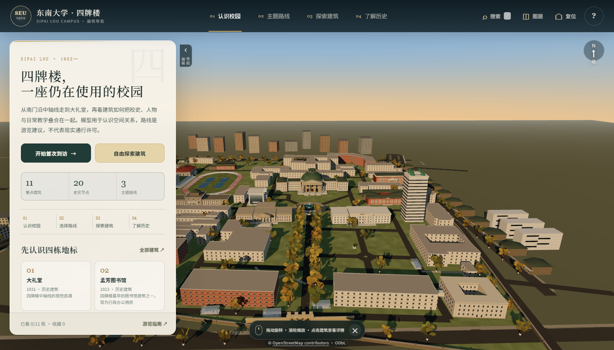

# 东南大学四牌楼 · 3D 建筑导览

打开 `index.html` 即可进入可漫游的四牌楼校园：11 处重点建筑、3 条主题路线、校史时间线，以及大礼堂、图书馆的室内空间示意。

**在线体验（GitHub Pages）：** https://zxyymx213253830-glitch.github.io/seu-sipailou-3d/  
**ModelScope 镜像：** https://modelscope.cn/studios/zxy615/seu-sipailou-3d

## 页面

- `index.html`：单文件 3D 导览，Three.js 与内容数据均已内嵌，可直接用浏览器打开，无需安装或联网。
- 支持拖拽旋转、滚轮缩放、点击建筑看详情、主题路线播放、搜索/收藏/图层，以及桌面与移动端布局。

## 校园图片

### 建筑与校园

| 图片 | 内容 |
|---|---|
| `images/campus/auditorium.jpg` | 大礼堂与铜绿穹顶 |
| `images/campus/auditorium-2017.jpg` | 大礼堂内景，2017 |
| `images/campus/auditorium-2024.jpg` | 大礼堂内景，2024 |
| `images/campus/roof-2017.jpg` | 大礼堂屋面与穹顶细部 |
| `images/campus/library.jpg` | 孟芳图书馆正立面 |
| `images/campus/library-renovation-01.jpg` … `06` | 图书馆修缮后的立面、柱廊与细部 |
| `images/campus/zhongda.jpg` | 中大院四柱门廊 |
| `images/campus/meian.jpg` | 梅庵 |
| `images/campus/autumn-walk.jpg` | 秋日校园步道 |
| `images/campus/centenary-ding.jpg` | 百年校庆铜鼎 |
| `images/campus/central-avenue-aerial.jpg` | 中轴线鸟瞰 |

### 地图

| 图片 | 内容 |
|---|---|
| `images/maps/campus-plan.jpg` | 校园总平面参考 |
| `images/maps/archives-map.jpg` | 档案馆藏校园图 |
| `images/maps/osm-plan.png` | OpenStreetMap 校园轮廓 |

### 界面截图

`images/screenshots/` 内是首页、建筑详情、主题路线、时间线、指南、移动端与模型校正的界面截图。

## 说明与边界

- 3D 模型是依据校方公开资料、OpenStreetMap 轮廓与实景照片辅助的程序化还原，不是测绘或实景扫描；大礼堂、图书馆室内为公开资料辅助的空间示意。
- 路线是游览建议，不代表当前通行、开放或拍摄许可；入校与场馆开放信息会变化，行前以校方最新通知为准。
- 校园照片来自东南大学校方公开页面，版权归原发布者，仅用于本项目的建筑形制核对与展示，未确认可公开再传播。
- 地图数据 © OpenStreetMap contributors，ODbL 1.0；Three.js 0.160.0，MIT。
